# SQL Server Database Replication Guide: Transactional Replication

A comprehensive, step-by-step technical guide for configuring **SQL Server Database Replication** using the **Publisher**, **Distributor**, and **Subscriber** architecture.

---

## Table of Contents

- [1. Overview of SQL Server Replication](#1-overview-of-sql-server-replication)
  - [1.1 What is SQL Server Replication?](#11-what-is-sql-server-replication)
  - [1.2 Core Roles: Publisher, Distributor, and Subscriber](#12-core-roles-publisher-distributor-and-subscriber)
  - [1.3 Types of SQL Server Replication](#13-types-of-sql-server-replication)
  - [1.4 When to Use SQL Server Replication](#14-when-to-use-sql-server-replication)
- [2. System Architecture](#2-system-architecture)
  - [2.1 Architecture Diagram](#21-architecture-diagram)
  - [2.2 Data Flow Explanation](#22-data-flow-explanation)
- [3. Prerequisites and Pre-Configuration](#3-prerequisites-and-pre-configuration)
  - [3.1 Hostname and Server Name Resolution](#31-hostname-and-server-name-resolution)
  - [3.2 SQL Server Agent and Network Ports](#32-sql-server-agent-and-network-ports)
- [4. Step-by-Step Technical Implementation](#4-step-by-step-technical-implementation)
  - [4.1 SQL Server Installation with Replication Feature](#41-sql-server-installation-with-replication-feature)
  - [4.2 Verifying Services, Instances, and Ports](#42-verifying-services-instances-and-ports)
  - [4.3 Configuring the Distributor Node](#43-configuring-the-distributor-node)
  - [4.4 Creating the Publication on the Publisher](#44-creating-the-publication-on-the-publisher)
  - [4.5 Configuring the Subscriber and Subscriptions](#45-configuring-the-subscriber-and-subscriptions)
  - [4.6 Verifying Replication Status and Synchronized Data](#46-verifying-replication-status-and-synchronized-data)
- [5. Monitoring and Best Practices](#5-monitoring-and-best-practices)
  - [5.1 Using Replication Monitor](#51-using-replication-monitor)
  - [5.2 Operational Best Practices](#52-operational-best-practices)

---

## 1. Overview of SQL Server Replication

### 1.1 What is SQL Server Replication?

**SQL Server Replication** is a built-in technology in Microsoft SQL Server that allows you to copy and distribute data and database objects from one database to another, and synchronize between databases to maintain data consistency.

Think of it like a magazine publishing company:
- A publisher prints articles.
- A distributor packages and routes the magazines.
- Subscribers receive and read the magazines at their homes.

Replication allows data to be copied automatically across different servers, locations, or cloud instances without manual export and import operations.

---

### 1.2 Core Roles: Publisher, Distributor, and Subscriber

SQL Server replication is built on three fundamental roles:

```
+----------------+      Transactions      +------------------+     Replicated Data    +-----------------+
|   Publisher    | ---------------------> |   Distributor    | ---------------------> |   Subscriber    |
| (Source / OLTP)|                        | (Queue & Engine) |                        | (Target / Read) |
+----------------+                        +------------------+                        +-----------------+
```

#### 1. The Publisher (The Source)
- **Role**: The source database instance that makes data available for replication.
- **Responsibilities**:
  - Defines the **Publication** (the collection of tables, views, and stored procedures to replicate).
  - Each item replicated is called an **Article**.
  - Tracks data changes (insert, update, delete) occurring on the published articles.

#### 2. The Distributor (The Intermediary / Queue)
- **Role**: The store-and-forward server that acts as the messaging broker between the Publisher and Subscriber.
- **Responsibilities**:
  - Hosts the special system database named `distribution`.
  - Holds transactions and snapshot files temporarily in queue before delivering them to subscribers.
  - Hosts replication background services (agents):
    - **Snapshot Agent**: Prepares schema and initial dataset.
    - **Log Reader Agent**: Monitors transaction logs of the publisher and moves changes to the distribution database.
    - **Distribution Agent**: Moves data from the distribution database to subscribers.
- **Deployment Models**:
  - *Local Distributor*: Runs on the same instance/server as the Publisher (simpler, uses fewer servers).
  - *Remote Distributor*: Runs on a dedicated server (reduces CPU/disk load on the production Publisher).

#### 3. The Subscriber (The Destination)
- **Role**: The target database instance that receives the replicated data.
- **Responsibilities**:
  - Subscribes to a publication to receive continuous data updates.
  - Houses the subscriber database where applications can read or query data.
  - Operates as either:
    - **Push Subscription**: The Distributor pushes changes directly to the Subscriber (managed at the Distributor).
    - **Pull Subscription**: The Subscriber periodically requests changes from the Distributor (reduces Distributor load).

---

### 1.3 Types of SQL Server Replication

| Replication Type | How It Works | Typical Use Case |
| :--- | :--- | :--- |
| **Snapshot Replication** | Takes a complete snapshot of data and schema at a specific point in time and replaces the destination data. | Small reference tables, infrequently changed lookup data. |
| **Transactional Replication** | Captures changes row-by-row in near real-time from the active transaction log and delivers them in order. | High-throughput OLTP systems, read-replica reporting, data warehousing. |
| **Merge Replication** | Allows changes to happen on both Publisher and Subscriber simultaneously and resolves conflicts automatically or by rule. | Mobile or offline branch offices synchronizing periodically. |

*This guide demonstrates **Transactional Replication**.*

---

### 1.4 When to Use SQL Server Replication

SQL Server Replication is ideal for the following real-world scenarios:

1. **Offloading Reporting and Analytical Queries (Read-Write Separation)**:
   - Primary OLTP databases must process customer transactions with low latency.
   - Long-running analytics or reporting queries can lock tables and degrade production performance.
   - *Solution*: Replicate transaction data to a secondary Subscriber database and direct all BI and reporting queries there.

2. **Geographical Data Distribution**:
   - Multi-branch businesses (e.g., retail chains, regional clinics, bank branches) require local low-latency access to master catalog data.
   - *Solution*: Replicate central catalog data to branch subscribers.

3. **Data Warehousing and Staging Feeds (ETL)**:
   - Continuously stream fresh operational changes to an intermediate staging server for ETL transformation without impacting production tables.

4. **High Availability and Disaster Recovery Preparation**:
   - Keep a warm secondary copy of critical tables updated in near real-time across data centers or cloud instances.

---

## 2. System Architecture

### 2.1 Architecture Diagram

The overall system architecture demonstrates the topology and communication flow between the Publisher node, the Distributor node, and the Subscriber node:

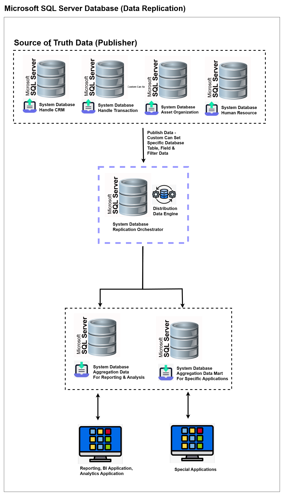

---

### 2.2 Data Flow Explanation

1. **Initial Baseline Synchronization**:
   - The **Snapshot Agent** captures the table schema (`.sch`) and baseline data (`.bcp`) from the Publisher and places them into the Replication Snapshot Share directory.
   - The **Distribution Agent** reads the snapshot and applies it to the destination database on the Subscriber.

2. **Continuous Transaction Streaming**:
   - When client applications perform `INSERT`, `UPDATE`, or `DELETE` operations on the Publisher, the changes are recorded in the Publisher's transaction log (`.ldf`).
   - The **Log Reader Agent** reads committed transactions from the log and copies them into the `distribution` database on the Distributor.
   - The **Distribution Agent** reads pending transactions from the `distribution` database and executes them on the Subscriber in exact sequential order.

---

## 3. Prerequisites and Pre-Configuration

### 3.1 Hostname and Server Name Resolution

SQL Server Replication relies strictly on actual server names (stored in `@@SERVERNAME`), not random hostnames or dynamic container IDs.

#### Checking Server Name:
Run this query on each SQL Server instance:
```sql
SELECT @@SERVERNAME AS CurrentServerName, SERVERPROPERTY('ServerName') AS ActualServerProperty;
```

#### Fixing Mismatched Server Names:
If `@@SERVERNAME` does not match the actual hostname (common in virtualized, cloned, or Docker environments), update it using the system stored procedures:

```sql
-- Step 1: Remove old server name registration
EXEC sp_dropserver 'OLD_SERVER_NAME';
GO

-- Step 2: Register new server name as local
EXEC sp_addserver 'NEW_SERVER_NAME', 'local';
GO
```
> **Important**: Restart the SQL Server service after running this script for the new name to take effect.

---

### 3.2 SQL Server Agent and Network Ports

Replication requires active background services and network connectivity:
1. **SQL Server Agent Service**: Must be configured to **Automatic** startup and currently running on all participating nodes.
2. **TCP/IP Protocol**: Must be enabled in SQL Server Configuration Manager.
3. **Firewall / Port Configuration**:
   - Default SQL Server instance: TCP Port `1433`.
   - Named instances: Ensure static TCP ports are assigned and reachable between nodes.
   - File Share (SMB): TCP Port `445` accessible for the Replication Snapshot folder.

---

## 4. Step-by-Step Technical Implementation

Below is the complete step-by-step technical implementation based on the sequential screenshots in the `ss/` directory.

---

### 4.1 SQL Server Installation with Replication Feature

#### Step 1: Launch SQL Server Setup
Start the SQL Server Installation Center from the installation media or ISO.

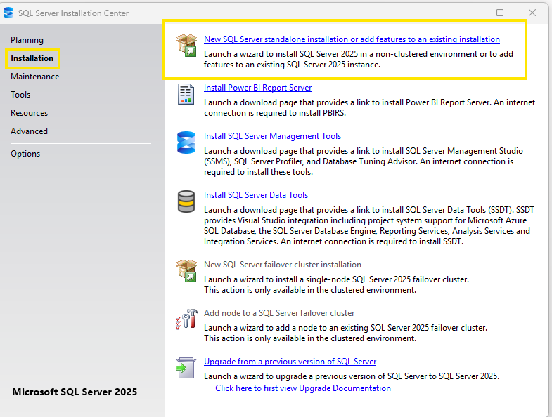
*Figure 4.1.1: SQL Server Installation Center landing page.*

---

#### Step 2: Choose New Stand-alone Installation
Under the **Installation** menu on the left, select **New SQL Server stand-alone installation or add features to an existing installation**.

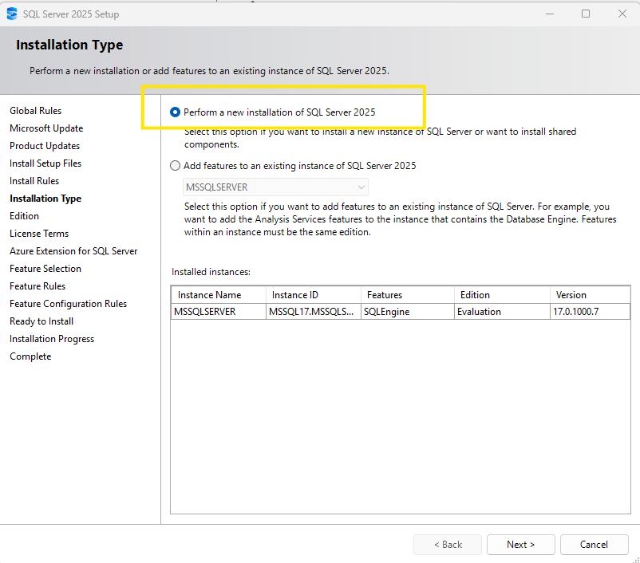
*Figure 4.1.2: Selecting new stand-alone installation.*

---

#### Step 3: Select Product Edition
Select the appropriate edition (e.g., Developer or Evaluation edition for non-production/testing environments) and click **Next**.

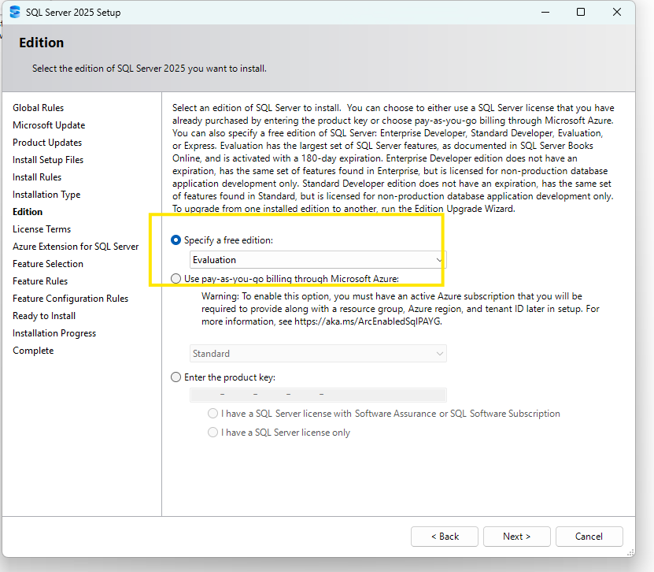
*Figure 4.1.3: Product Key and Edition selection.*

---

#### Step 4: Enable SQL Server Replication Feature
In the **Feature Selection** step, check **Database Engine Services** and ensure **SQL Server Replication** is selected.

> **Crucial Requirement**: The replication components will not be installed if this checkbox is left unchecked.

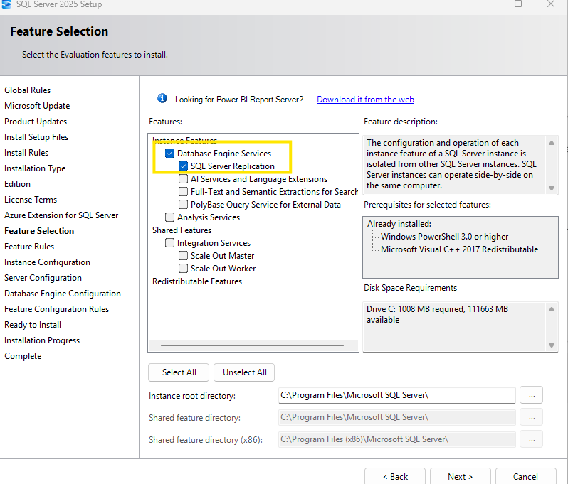
*Figure 4.1.4: Enabling SQL Server Replication in Feature Selection.*

---

#### Step 5: Configure Instance Name
Specify whether to install as the Default instance (`MSSQLSERVER`) or a Named instance (e.g., `DISTRIBUTOR` or `SUBSCRIBER`).

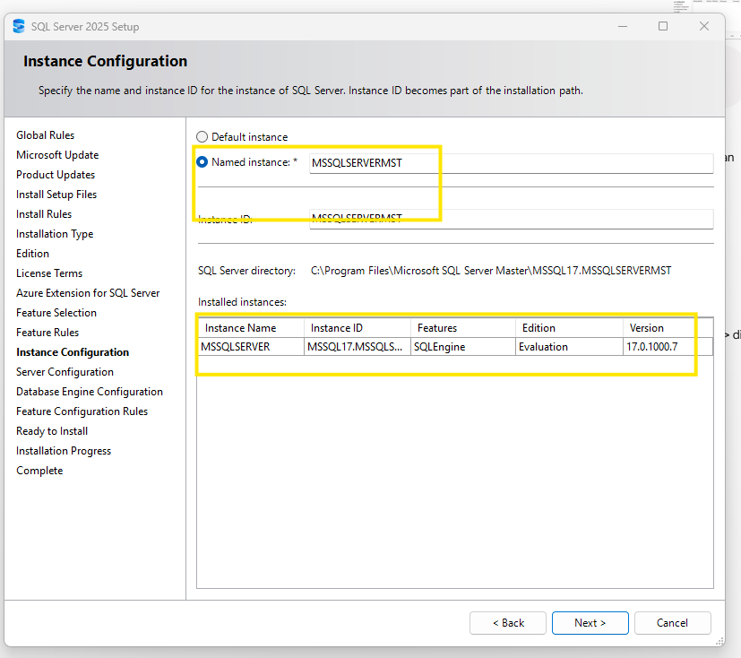
*Figure 4.1.5: Specifying SQL Server instance name and instance ID.*

---

#### Step 6: Configure Authentication Mode
In the **Database Engine Configuration** step, select **Mixed Mode (SQL Server authentication and Windows authentication)** and assign a secure password for the `sa` account. Add the current user as a SQL Server Administrator.

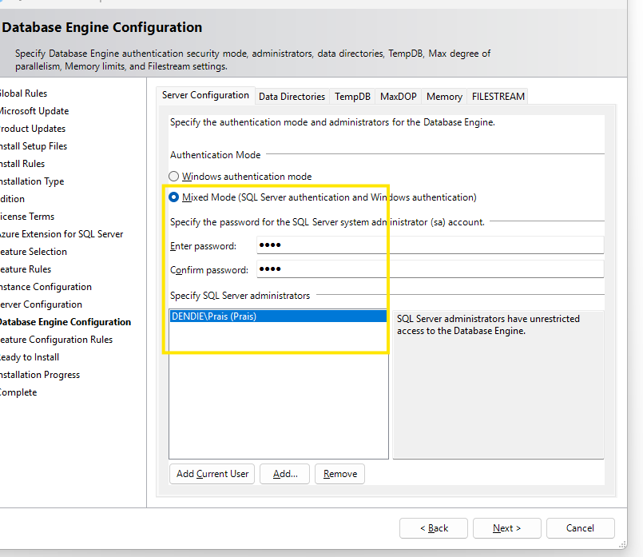
*Figure 4.1.6: Configuring Mixed Mode Authentication.*

---

#### Step 7: Complete Installation
Review the installation progress until all components display a status of **Succeeded**.

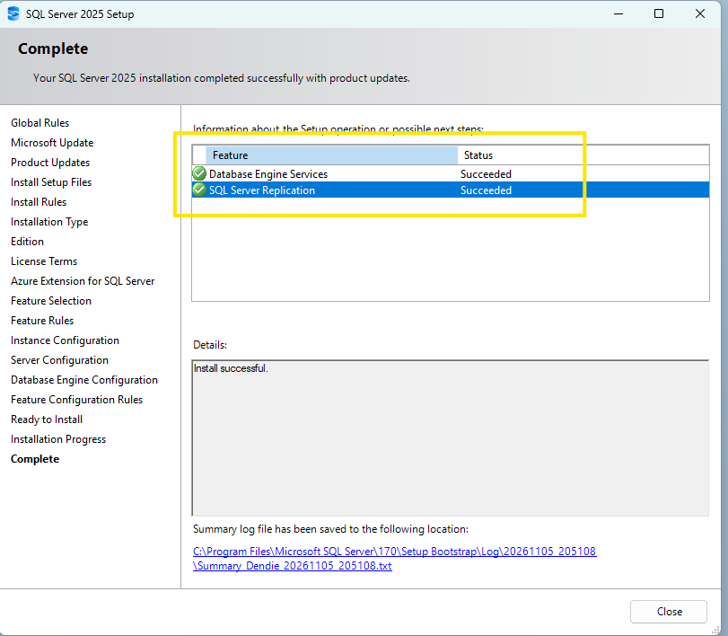
*Figure 4.1.7: Successful completion of SQL Server installation.*

---

### 4.2 Verifying Services, Instances, and Ports

#### Step 8: Verify SQL Server and SQL Server Agent Services
Open **Services** (`services.msc`) or **SQL Server Configuration Manager**. Verify that:
- **SQL Server (Instance Name)** is running.
- **SQL Server Agent (Instance Name)** is running and set to Automatic startup.

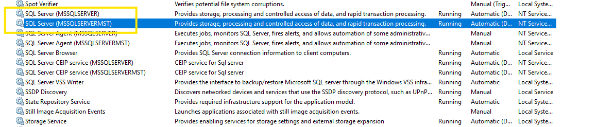
*Figure 4.2.1: Verifying active SQL Server and Agent services across instances.*

---

#### Step 9: Check Publisher TCP/IP Port
In SQL Server Configuration Manager, check the TCP/IP protocol properties under **SQL Server Network Configuration** for the Publisher instance to identify its active listening port.

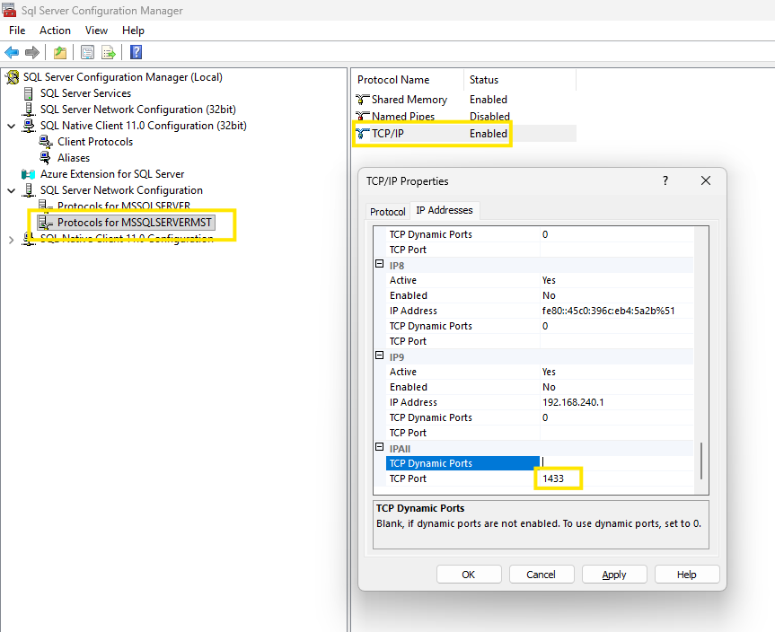
*Figure 4.2.2: Checking TCP/IP port assignment for the Publisher node.*

---

#### Step 10: Check Distributor TCP/IP Port
Verify the TCP/IP listening port configuration for the Distributor instance to ensure network reachability.

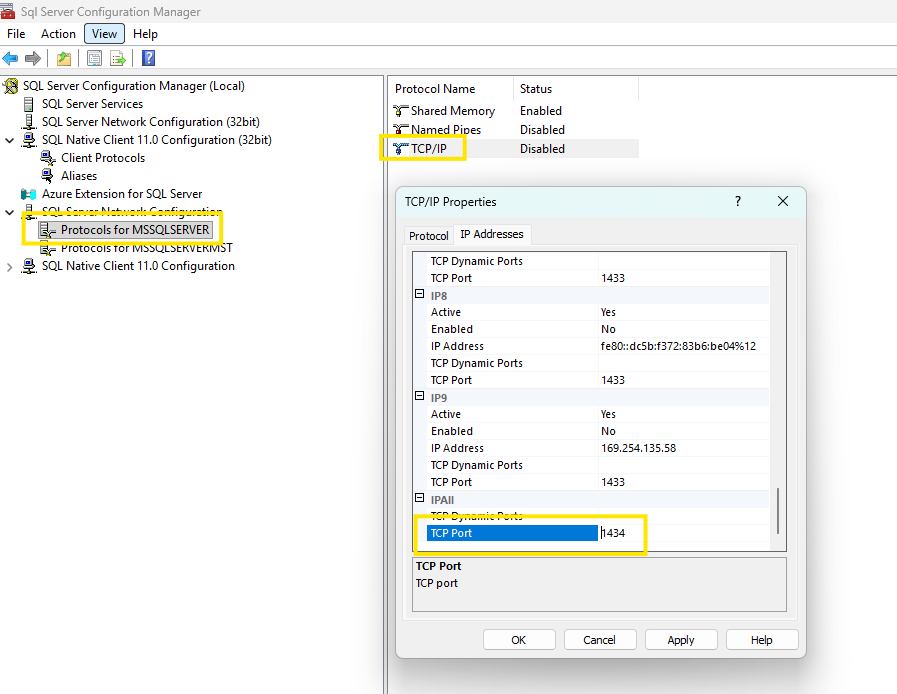
*Figure 4.2.3: Checking TCP/IP port configuration for the Distributor node.*

---

#### Step 11: Connect Instances in SQL Server Management Studio (SSMS)
Open SSMS and establish connections to both the Master/Publisher instance and the Slave/Subscriber instance. Confirm both connections are active.

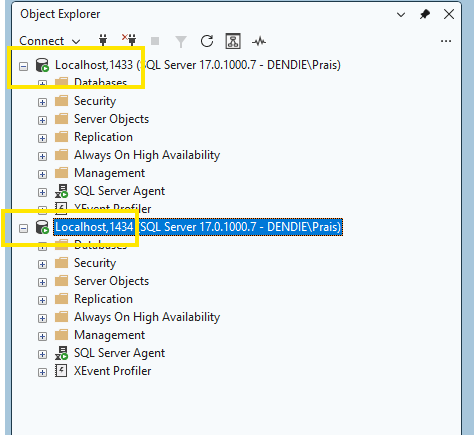
*Figure 4.2.4: Connected Publisher and Subscriber instances in SSMS Object Explorer.*

---

### 4.3 Configuring the Distributor Node

#### Step 12: Launch Configure Distribution Wizard
In Object Explorer, expand the instance acting as the Distributor, right-click the **Replication** folder, and select **Configure Distribution...**.

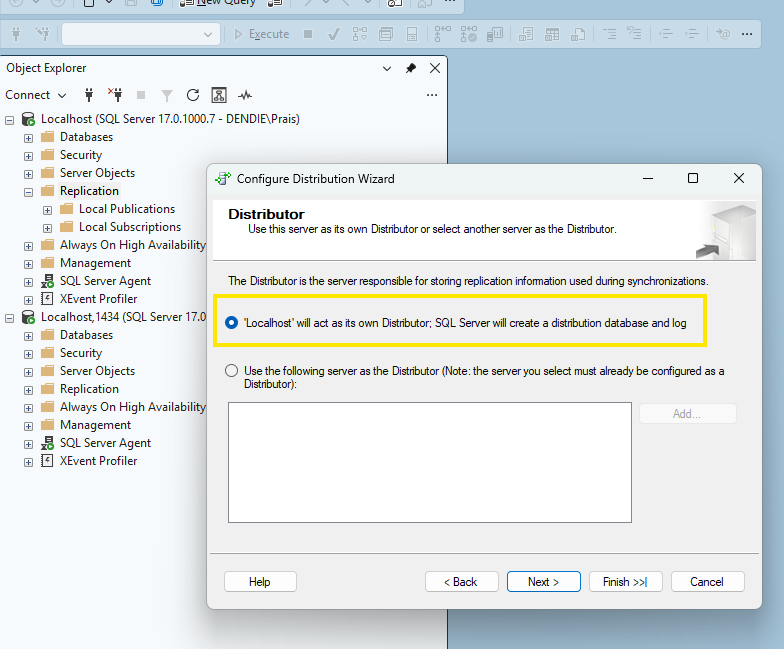
*Figure 4.3.1: Starting the Configure Distribution Wizard.*

---

#### Step 13: Define Snapshot Folder
Set the distribution database name (`distribution`) and specify the network or local path for the **Snapshot Folder** where snapshot data files will be stored.

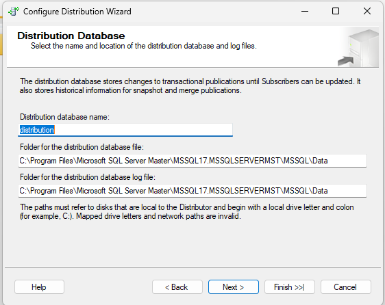
*Figure 4.3.2: Specifying the Snapshot folder location.*

---

#### Step 14: Finalize Distribution Configuration
Review the configuration summary, select **Configure distribution**, and click **Finish** to initialize the distributor database and services.

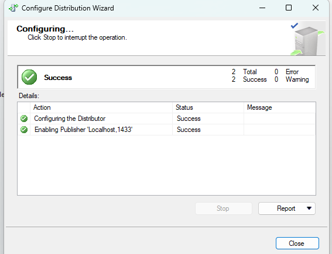
*Figure 4.3.3: Successfully configuring the Distribution node.*

---

### 4.4 Creating the Publication on the Publisher

#### Step 15: Identify the Source Database
Verify the database on the Publisher that contains the tables, records, and schema to be replicated.

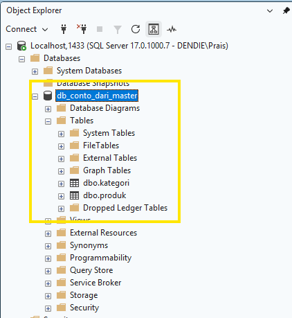
*Figure 4.4.1: Checking source database and schema on the Publisher.*

---

#### Step 16: Verify Server Name Metadata on Publisher
Execute `SELECT @@SERVERNAME;` on the Publisher to confirm that internal SQL Server metadata matches the physical/network hostname.

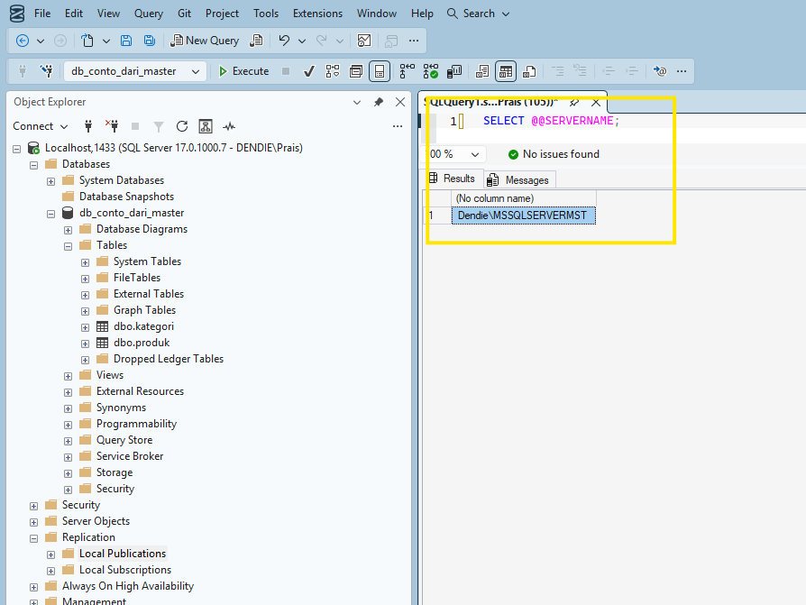
*Figure 4.4.2: Verifying Publisher @@SERVERNAME output.*

---

#### Step 17: Launch New Publication Wizard
Under the **Replication** folder on the Publisher instance, right-click **Local Publications** and select **New Publication...**.

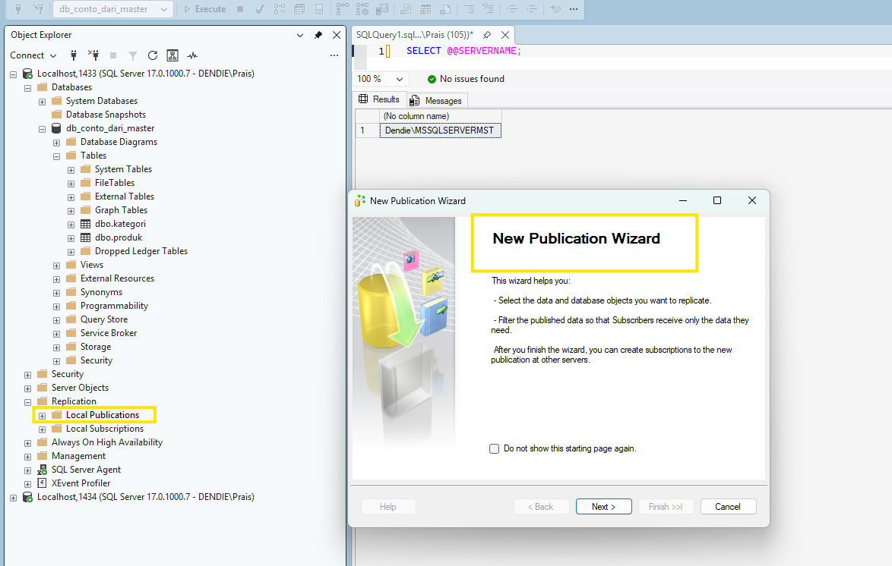
*Figure 4.4.3: Launching the New Publication Wizard.*

---

#### Step 18: Select the Publication Database
Choose the database that contains the tables and data you want to publish.

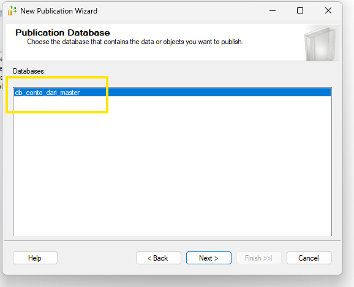
*Figure 4.4.4: Choosing the database to replicate.*

---

#### Step 19: Choose Publication Type (Transactional Publication)
Select **Transactional publication**. This ensures that data modifications (inserts, updates, deletes) are propagated to subscribers near real-time.

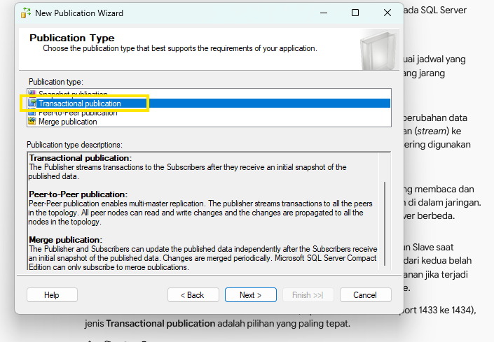
*Figure 4.4.5: Selecting Transactional publication.*

---

#### Step 20: Select Articles (Tables and Objects)
In the **Articles** window, check the tables you wish to replicate.

> **Note**: For Transactional Replication, tables must have a **Primary Key** defined.

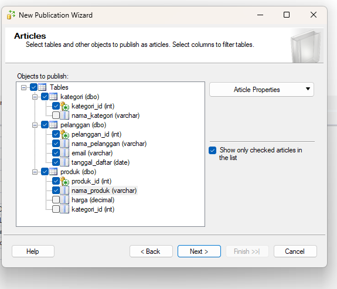
*Figure 4.4.6: Selecting tables (articles) for replication.*

---

#### Step 21: Filter Table Rows (Optional)
If you only need a subset of rows (e.g., rows where `Region = 'North'`), add filter clauses here. Otherwise, leave blank to replicate full tables.

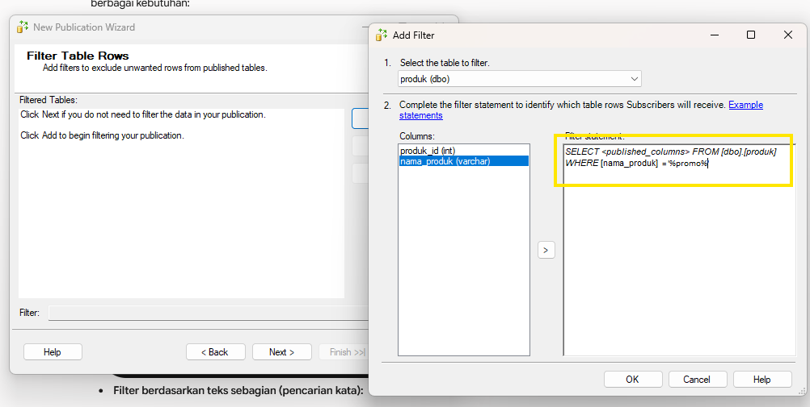
*Figure 4.4.7: Configuring row filtering (or leaving full dataset).*

---

#### Step 22: Configure Snapshot Agent Schedule and Name
Schedule when the Snapshot Agent will generate the initial snapshot (or set it to create immediately). Provide a descriptive name for the publication.

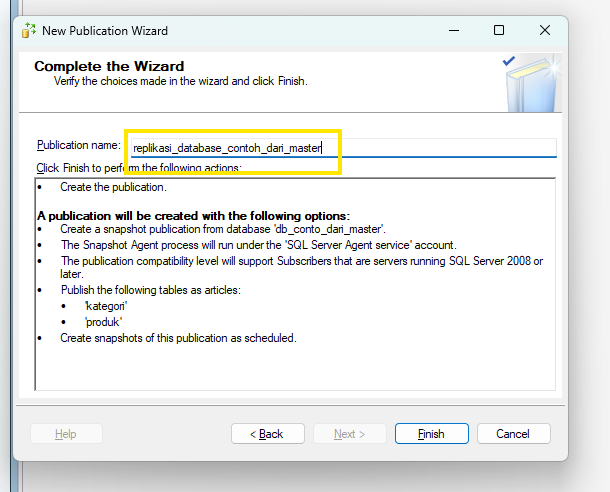
*Figure 4.4.8: Setting the publication name and snapshot schedule.*

---

#### Step 23: Complete Publication Creation
Click **Finish** to initiate the publication creation process. The wizard creates the publication, activates the articles, and starts the Log Reader Agent.

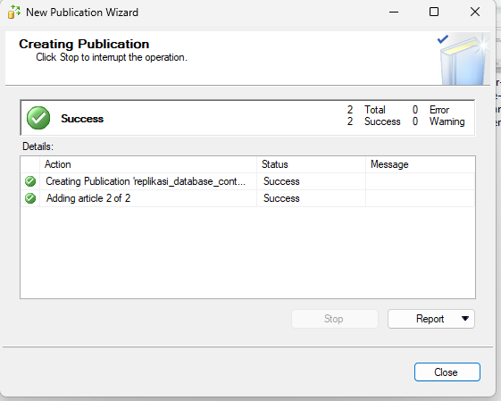
*Figure 4.4.9: Publication creation progress and summary.*

---

#### Step 24: Verify Created Publication in SSMS
Expand **Replication** > **Local Publications** to verify that your new publication is listed and active.

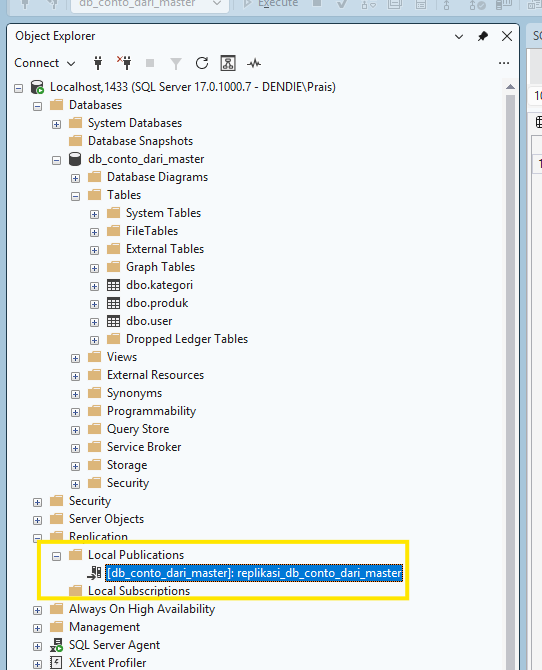
*Figure 4.4.10: Active publication listed under Local Publications.*

---

### 4.5 Configuring the Subscriber and Subscriptions

#### Step 25: Launch New Subscription Wizard
Right-click your newly created publication and select **New Subscriptions...**.

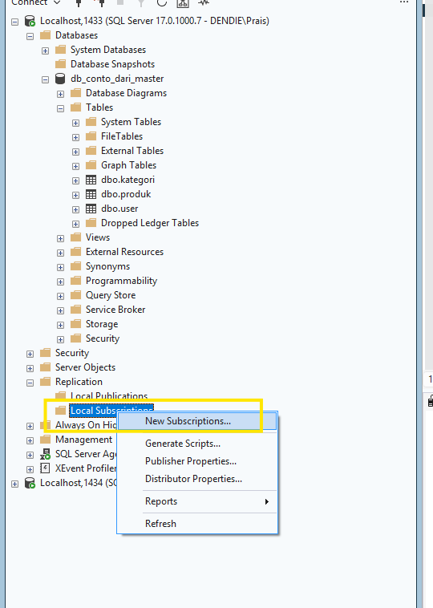
*Figure 4.5.1: Starting the New Subscription Wizard.*

---

#### Step 26: Select Publication for Subscription
Confirm that the correct publication is selected from the list.

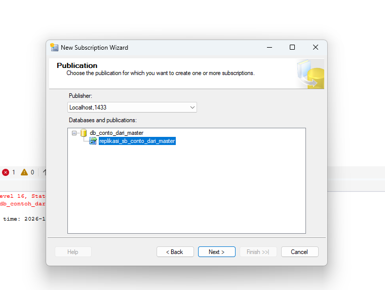
*Figure 4.5.2: Selecting the target publication.*

---

#### Step 27: Select Distribution Agent Location (Push vs. Pull)
Choose between:
- **Push subscription** (Run all agents at the Distributor).
- **Pull subscription** (Run each agent at its Subscriber).

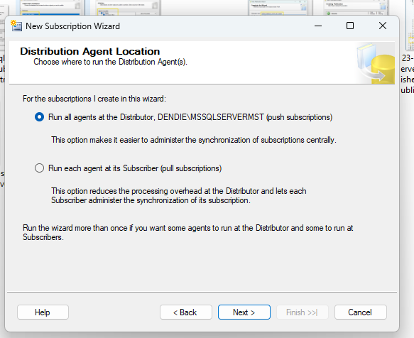
*Figure 4.5.3: Selecting Push or Pull subscription model.*

---

#### Step 28: Add Subscriber Instance and Target Database
Click **Add Subscriber** to browse and connect to the Subscriber instance. Select or create the destination subscription database.

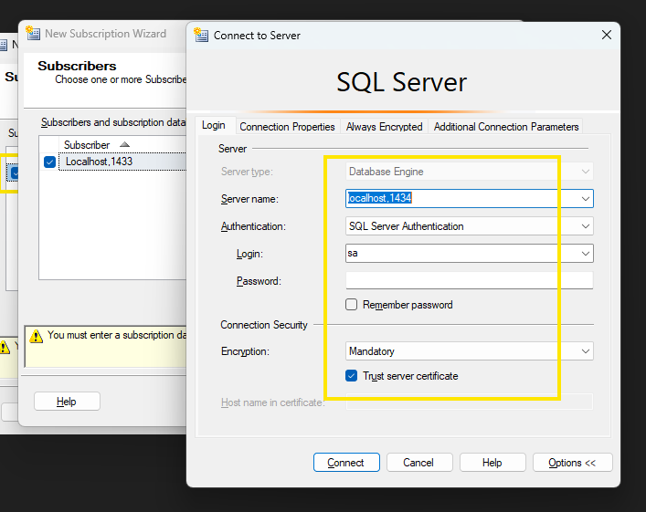
*Figure 4.5.4: Assigning subscriber instance and subscription database.*

---

#### Step 29: Configure Distribution Agent Security
Set the security account used by the Distribution Agent process. You can use the SQL Server Agent service account or a dedicated Windows domain/local account.

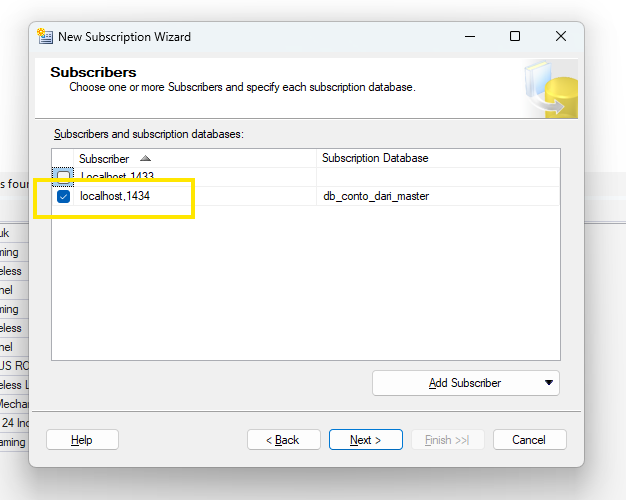
*Figure 4.5.5: Configuring process and connection credentials.*

---

#### Step 30: Set Synchronization Schedule
Select **Run continuously** so changes made on the Publisher are replicated immediately to the Subscriber.

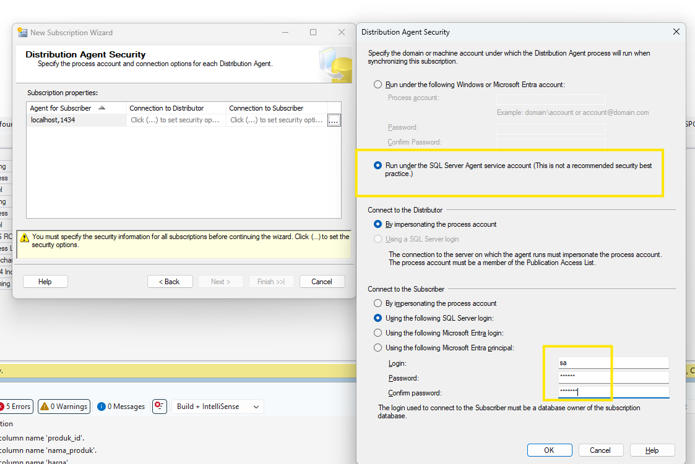
*Figure 4.5.6: Configuring synchronization schedule.*

---

#### Step 31: Initialize Subscription
Check **Initialize Immediately** and set the start condition to **At first synchronization**. This tells the agent to apply the snapshot as soon as the subscription is created.

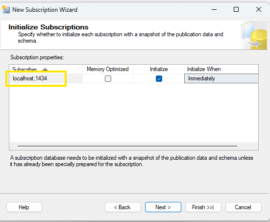
*Figure 4.5.7: Initializing subscription with snapshot.*

---

#### Step 32: Choose Wizard Actions
Select **Create the subscription(s)** (and optionally generate a script for backup purposes).

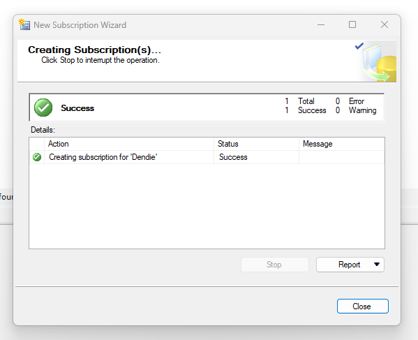
*Figure 4.5.8: Choosing wizard execution action.*

---

#### Step 33: Review Summary and Execute
Review all configured settings in the summary screen and click **Finish**.

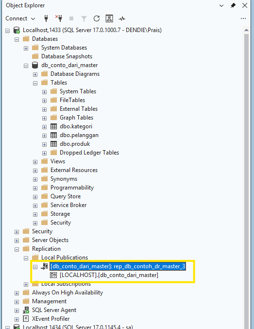
*Figure 4.5.9: Subscription creation summary.*

---

#### Step 34: Subscription Successfully Created
The wizard confirms that the subscription has been successfully registered and initialized.

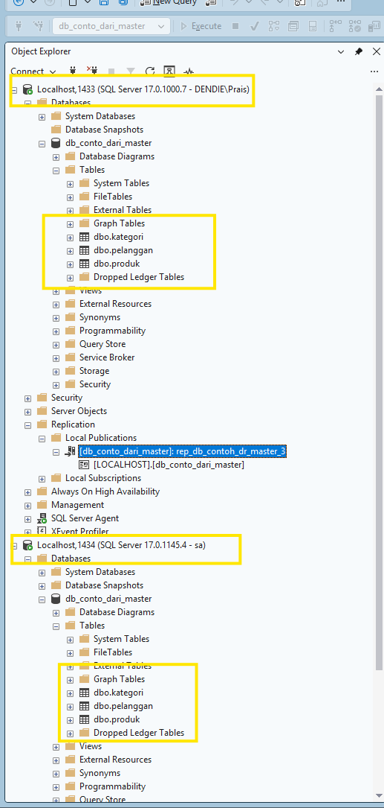
*Figure 4.5.10: Confirmation of successful subscription creation.*

---

### 4.6 Verifying Replication Status and Synchronized Data

#### Step 35: Launch Replication Monitor
Right-click the **Replication** folder in SSMS and select **Launch Replication Monitor**.

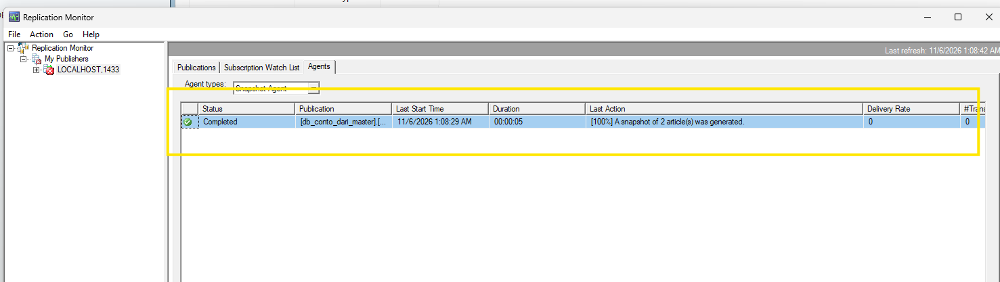
*Figure 4.6.1: Opening Replication Monitor.*

---

#### Step 36: Monitor Replication Health and Agents
In Replication Monitor:
- Verify that **Log Reader Agent** is running with status `Running`.
- Verify that **Distribution Agent** has delivered the snapshot and is continuously synchronizing.
- Check latency metrics and error logs if any warnings appear.

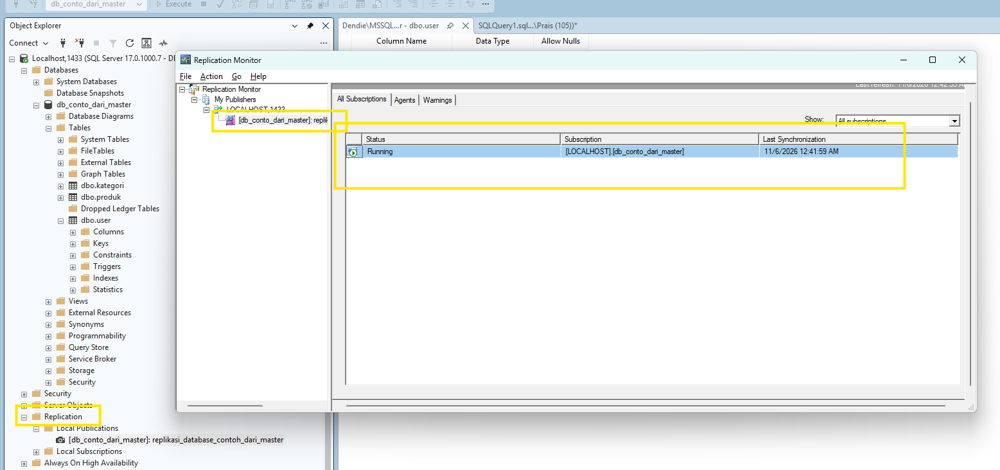
*Figure 4.6.2: Verifying agent statuses and synchronization in Replication Monitor.*

---

#### Step 37: Verify Subscriber Authentication and Connection
Switch connection context to the Subscriber instance. Verify connection credentials and access rights to the subscription database.

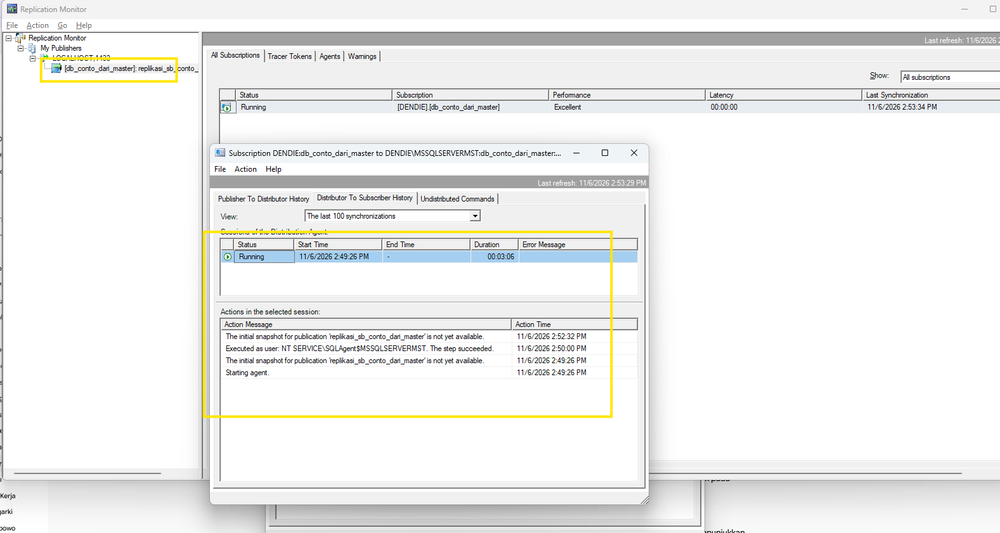
*Figure 4.6.3: Validating login and permissions on Subscriber.*

---

#### Step 38: Verify Database Objects on Subscriber
Inspect the subscription database in SSMS Object Explorer. Verify that all published tables, constraints, and indexes have been created.

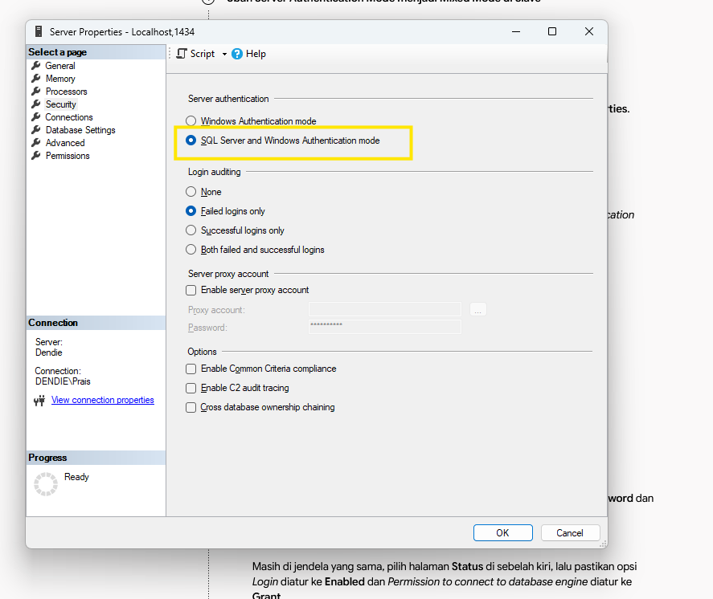
*Figure 4.6.4: Replicated tables appearing in Subscriber database.*

---

#### Step 39: Query Data on Subscriber Node
Execute `SELECT` queries on the replicated tables on the Subscriber to verify initial snapshot population.

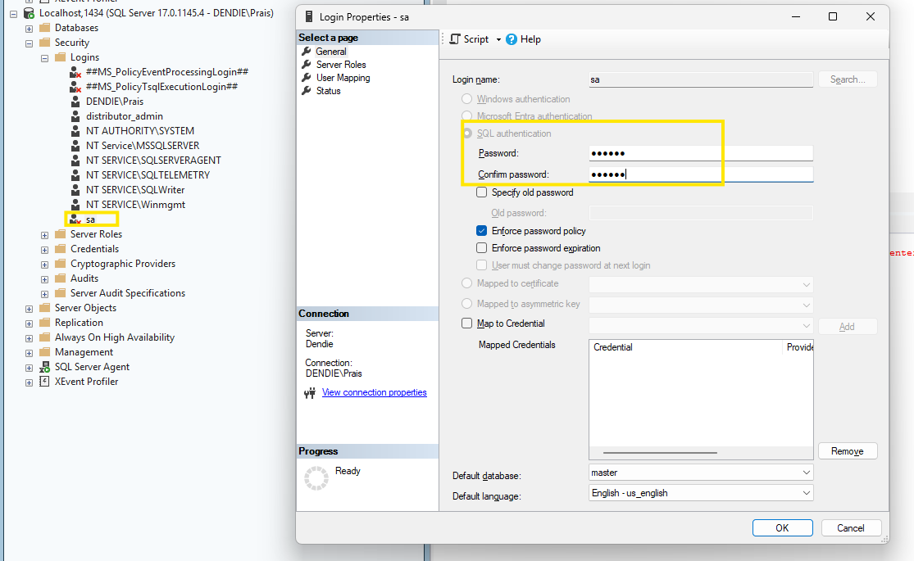
*Figure 4.6.5: Querying replicated records on Subscriber.*

---

#### Step 40: Test Live Data Synchronization
Insert a new record or update an existing row on the Publisher database. Query the same table on the Subscriber to ensure the change is replicated within seconds.

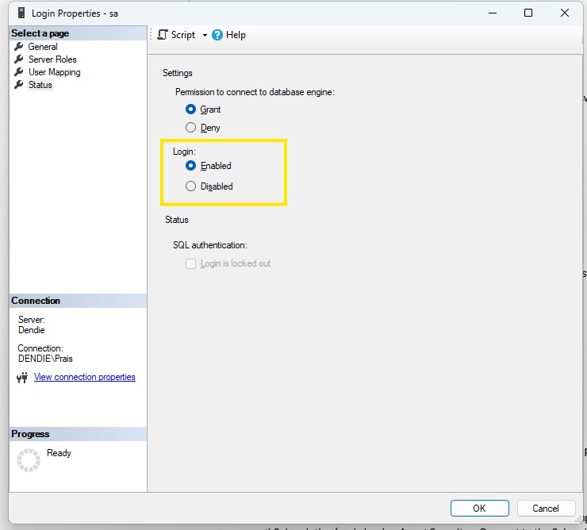
*Figure 4.6.6: Validating real-time row synchronization.*

---

#### Step 41: End-to-End Replication Confirmation
Review table row counts and ensure both Publisher and Subscriber are fully synchronized and healthy.

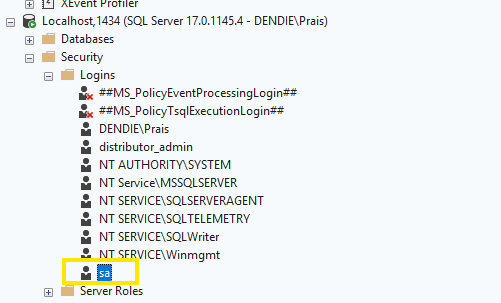
*Figure 4.6.7: Final verification of healthy end-to-end replication.*

---

## 5. Monitoring and Best Practices

### 5.1 Using Replication Monitor

**SQL Server Replication Monitor** is the primary tool for ongoing administrative tasks:
- **Agent Status**: Quick visual indicators (Green checkmark, yellow warning, red error).
- **Undelivered Commands**: Shows transaction backlog in the distribution queue waiting to be delivered.
- **Latency Monitoring**: Measures how long it takes for a committed transaction on the Publisher to be applied on the Subscriber.
- **Tracer Tokens**: Insert a tracer token into the transaction log from Replication Monitor to measure exact latency across all replication legs.

---

### 5.2 Operational Best Practices

1. **Keep SQL Server Agent Running**:
   - Replication agents run as SQL Server Agent jobs. Ensure the agent service is set to start automatically on system reboot.
2. **Proper Sizing for Distribution Database**:
   - Set an appropriate retention period for distribution transactions (default is 72 hours). Avoid letting the `distribution` database grow uncontrollably.
3. **Dedicated Network and Disk for High-Throughput Scenarios**:
   - If transaction volume is very high, place the Distributor on a separate server to avoid CPU and disk I/O contention on the production Publisher.
4. **Primary Key Requirement**:
   - Every table participating in Transactional Replication must have a primary key. Plan table designs accordingly.
5. **Monitor Transaction Log Growth on Publisher**:
   - Transactions cannot be truncated from the Publisher's log until the Log Reader Agent has read them into the distribution database. If the Log Reader stops, the transaction log will grow.
